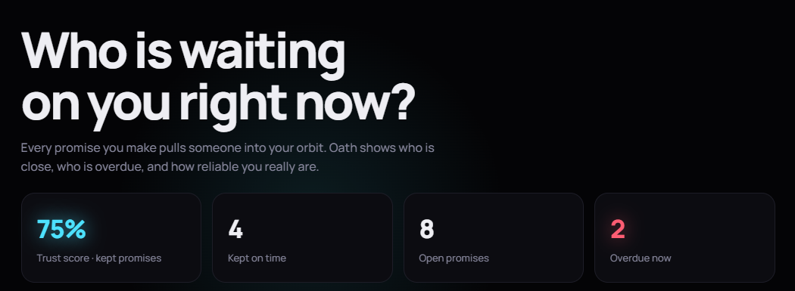
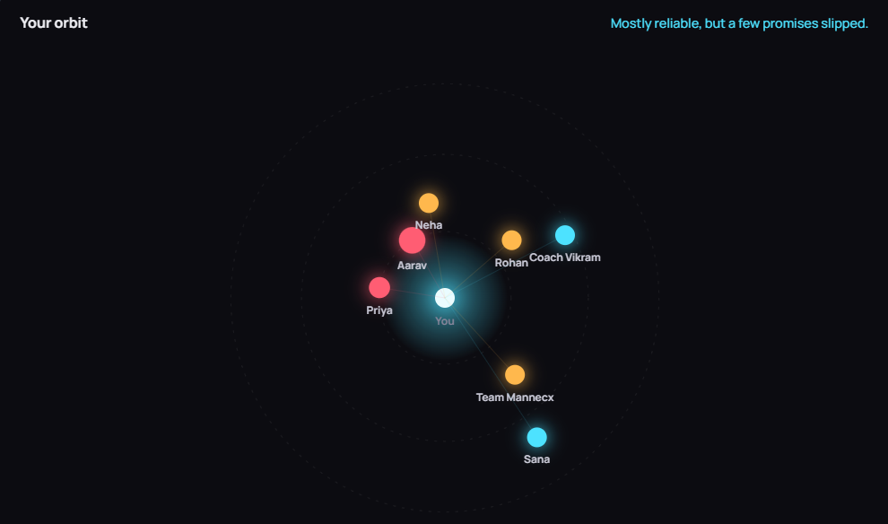
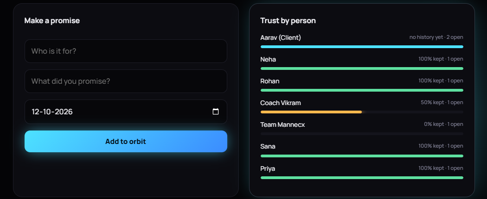
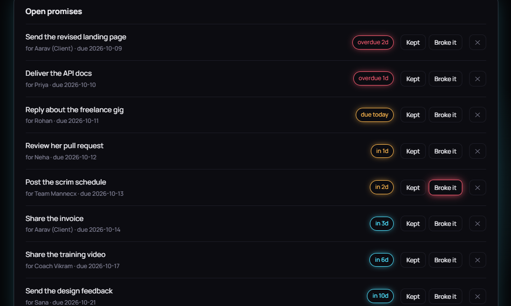

<div align="center">

# Oath

**Never break a promise by accident.**

Track every promise you make and see, in a live orbit, who is waiting on you.

[](https://oath-pr0u.onrender.com)
[](https://github.com/manashwebdev/oath/actions/workflows/ci.yml)


[](LICENSE)



</div>

---

## The problem

You tell a client "I'll send it Friday", a teammate "I'll review your PR", a friend "I'll call you back". Then life happens and you forget. Missed promises quietly cost you clients, teammates and trust, and no tool shows who is actually waiting on you.

Oath makes every open promise visible. Each person becomes a planet in your orbit: the closer they are to you, the more urgent your promise to them. It also scores how reliable you really are.

## Features

- **Live orbit visualization**: an animated canvas where distance equals urgency. Overdue promises pulse red, due-soon ones glow amber, people you owe nothing sit far out in green. Hover for details, click a planet to filter.
- **Trust score**: an overall reliability percentage, plus a reliability bar for every person.
- **Promise log**: add who, what and when. Mark each one as kept or broken.
- **Smart ordering**: open promises are sorted by urgency with clear labels (`overdue 2d`, `due today`, `in 3d`).
- **Demo data loader** for an instant populated dashboard.
- **Premium UI**: dark theme, cursor glow, animated counters and bars, responsive layout, reduced-motion support.
- **Zero dependencies**: just Node.js. Nothing to install.

## Screenshots



| Make a promise and trust by person |
|---|
|  |



## How to use

1. **Make a promise.** Enter who it is for, what you promised and the due date, then click **Add to orbit**. A new planet appears.
2. **Read the orbit.** Planets close to the center need attention first. Red means overdue.
3. **Filter.** Click a planet (or a name under *Trust by person*) to see only that person's promises. Click again to clear.
4. **Resolve.** When you deliver, click **Kept**. If you could not, click **Broke it**. Both update your trust score.
5. **Watch your score.** Check the trust score and per-person bars to see where you are slipping.

New here? Click **Load demo data** to explore a filled orbit.

## How scoring works

| Outcome | Points |
|---|---|
| Kept on or before the due date | 1 |
| Kept after the due date | 0.5 |
| Broken | 0 |

The trust score is the average across all resolved promises. Per-person scores use only that person's promises.

## Getting started

Requires **Node.js 18 or newer**. No `npm install` needed.

```bash
git clone https://github.com/manashwebdev/oath.git
cd oath
npm start
```

Open **http://localhost:4000**.

Development mode with auto-restart:

```bash
npm run dev
```

### Environment variables

Copy `.env.example` to `.env` to customize. Node 20.6+ can load it directly:

```bash
node --env-file=.env server/server.js
```

| Variable | Default | Purpose |
|---|---|---|
| `PORT` | `4000` | Port the server listens on |
| `DB_FILE` | `data/db.json` | Path of the JSON data file |

## Testing

The core logic (status rules, scoring, grouping) and the REST API are covered by automated tests using Node's built-in test runner:

```bash
npm test
```

| File | Covers |
|---|---|
| `test/stats.test.js` | Promise status (open, overdue, kept, late, broken), scoring weights, per-person grouping, verdicts, empty state |
| `test/api.test.js` | Starts the real server and tests validation, create, list, resolve, delete, overview and seeding |

A GitHub Actions workflow (`.github/workflows/ci.yml`) runs the suite on every push and pull request across Node 18, 20 and 22.

## API reference

| Method | Endpoint | Description |
|---|---|---|
| `GET` | `/api/promises` | List promises with `status` and `daysLeft` |
| `POST` | `/api/promises` | Create one: `{ who, what, due: "YYYY-MM-DD" }` |
| `POST` | `/api/promises/:id/resolve` | Resolve one: `{ result: "kept" \| "broken" }` |
| `DELETE` | `/api/promises/:id` | Delete a promise |
| `GET` | `/api/overview` | Trust score, counts, per-person reliability |
| `POST` | `/api/seed` | Load demo data (only when the store is empty) |

```bash
curl -X POST http://localhost:4000/api/promises \
  -H "Content-Type: application/json" \
  -d '{"who":"Aarav","what":"Send the invoice","due":"2026-10-20"}'
```

## Tech stack

| Layer | Technology |
|---|---|
| Backend | Node.js built-in `http` module, REST API |
| Storage | JSON file store |
| Frontend | Vanilla JavaScript, HTML5 Canvas, CSS animations |
| Testing | `node:test` |
| CI | GitHub Actions |
| Hosting | Render |

## Project structure

```
oath/
├── server/
│   ├── server.js      # HTTP server, routing, static files
│   ├── stats.js       # Status rules, scoring, overview (pure functions)
│   └── store.js       # JSON persistence and demo seed
├── public/
│   ├── index.html
│   ├── styles.css     # Glow, motion, layout
│   └── app.js         # State, canvas orbit, rendering
├── test/              # Unit and API tests
├── docs/screenshots/
├── .github/workflows/ci.yml
├── .env.example
├── LICENSE
└── package.json
```

## Deployment

1. Push the repository to GitHub.
2. Create a **Web Service** on [Render](https://render.com) and connect the repo.
3. Leave the build command empty and set the start command to `npm start`.

The free tier sleeps when idle, so the first request after a pause can take about 30 seconds. Its filesystem is also temporary, so saved promises reset on redeploy. For permanent storage, swap `server/store.js` for a database such as MongoDB.

## Roadmap

- [ ] MongoDB storage for persistent data
- [ ] User accounts, so each person keeps a private orbit
- [ ] Reminders before a promise is due
- [ ] Renegotiate a due date instead of only keeping or breaking
- [ ] Trust score trend over time

## Author

Built by **Manash Khati** ([@manashwebdev](https://github.com/manashwebdev)).

## License

Released under the [MIT License](LICENSE).
